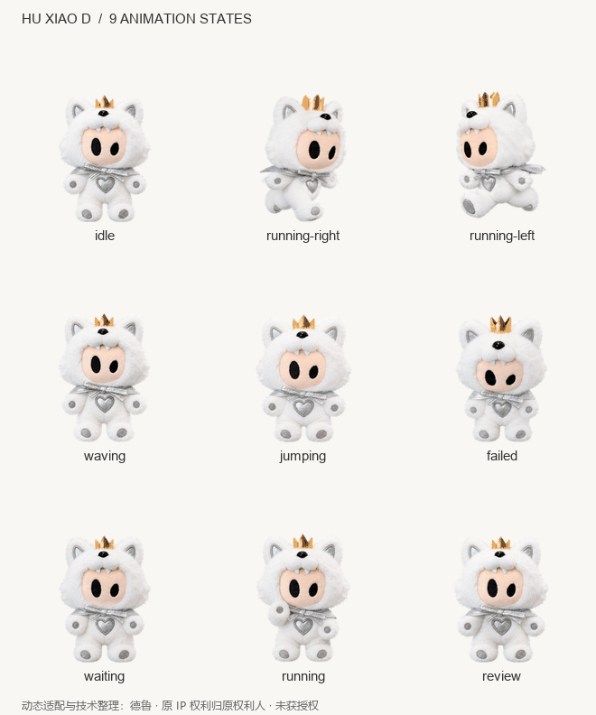

# 狐小D · Hu Xiao D

戴着金冠和银色披风的毛绒小狐狸，陪你认真工作。


**动态适配与技术整理：德鲁 · 非官方同人适配 · Codex 桌面宠物 v2**

> 原 IP 来源：薛之谦相关周边 IP 玩偶「狐小D」。原角色及形象相关权利归原权利人所有。本项目未获得原 IP 权利人的授权，不授予角色素材的商用、改编或再分发许可。公开可访问不代表取得授权，详见 [权利声明](RIGHTS-NOTICE.md)。

[安装指南](INSTALL.md) · [复制安装提示词](INSTALL-PROMPT.md) · [完整动作预览](previews/all-states.gif) · [授权与署名](LICENSE.md) · [English](README_EN.md)

## 让 Codex 帮你安装

将下面整段发给能够访问本机文件和网络的 Codex。安装前请阅读 [权利声明](RIGHTS-NOTICE.md)：

```text
请从 https://github.com/DFqqq/codex-huxiaod 帮我安装 Codex 桌面宠物「狐小D」（动态适配与技术整理：德鲁，ID：hu-xiao-d）。
获取仓库；如果当前目录已经是这个仓库，可直接使用。阅读 RIGHTS-NOTICE.md；原 IP 为薛之谦相关周边「狐小D」，本项目未获原 IP 权利人授权。保留随包权利声明和署名。
先阅读 AGENTS.md 和 INSTALL.md，确认 pets/hu-xiao-d/pet.json 及其引用的精灵图存在。
优先运行 scripts/install.py；尊重 CODEX_HOME，未设置时用当前用户的 ~/.codex。
安装前校验 SHA256SUMS；已有不同版本时先备份，保持素材原始字节，最后写入 pet.json。
不要修改其他宠物或全局设置。安装后核对目标文件哈希，告诉我实际路径和如何启用狐小D。
```

已下载文件夹或单宠物安装包时，也可以使用 [本地安装提示词](INSTALL-PROMPT.md#已下载仓库或安装包)。

## 自己安装

进入仓库根目录，运行以下命令之一（需要 Python 3.8+，无需安装第三方依赖）：

```powershell
# Windows
python scripts/install.py
```

```bash
# macOS / Linux
python3 scripts/install.py
```

随后打开 **设置 → Pets → Refresh（刷新）→ 选择「狐小D」**，输入 `/pet` 显示宠物。也可以不用 Python，按 [手动安装指南](INSTALL.md#手动安装无需-python) 复制文件。

## 它会做什么



| 动作 | 通常何时出现 |
| --- | --- |
| 待机 | 没有需要展示的任务状态时，眨眼、轻微起伏 |
| 向左跑 / 向右跑 | 鼠标按住宠物左右拖动 |
| 挥手 | 首次唤醒的欢迎提示 |
| 跳跃 | 鼠标移入宠物身体区域 |
| 失败 | 任务失败或系统错误 |
| 等待 | 任务需要用户回答、批准或选择 |
| 工作 / 思考 | 任务正在进行 |
| 检查 / 完成 | 有已完成、待查看的结果 |
| 16 方向环顾 | 应用提供指向目标时，依据运行时决定 |

具体触发由应用控制。上表核对于 Windows 桌面版 26.1016.6573.0 的本机实现；素材预览是逐帧回放，不代表每个动作能通过命令手动触发。多个任务同时存在时，实际展示还取决于应用的状态优先级。

## 包里有什么

```text
pets/hu-xiao-d/
  pet.json                   # 名称、ID 与 v2 素材声明
  spritesheet.webp           # 1536 × 2288，透明原始精灵图
  SHA256SUMS                 # 两个运行文件的校验值
  ATTRIBUTION.md             # 可直接复制的署名
  RIGHTS-NOTICE.md           # 原 IP 来源与未获授权说明
```

桌面端自定义宠物存放在本机，不会自动同步到网页版。桌面端的安装方式与网页版的上传功能不同；本包按桌面端 v2 格式准备。参见 [OpenAI 官方 Pets 说明](https://learn.chatgpt.com/docs/pets)。

## 来源、署名与安装代码许可

原 IP 来源为薛之谦相关周边 IP 玩偶「狐小D」。原角色、名称及形象相关权利归原权利人所有，具体权利主体及授权范围尚未核实。本项目未获原 IP 权利人授权；角色素材、精灵图和衍生预览不适用安装代码的 MIT 许可。

标注示例：

> 原 IP：薛之谦相关周边「狐小D」，相关权利归原权利人所有。动态适配与技术整理：德鲁。非官方同人适配，未获原 IP 权利人授权。

仅 `scripts/` 下的安装代码保留 [MIT](LICENSE-MIT.txt)。详细范围见 [LICENSE.md](LICENSE.md) 与 [权利声明](RIGHTS-NOTICE.md)。本次更正不代表已解决素材公开传播所需的授权；先前文档中的素材许可表述不能代替原 IP 权利人的许可。

## 状态与兼容性

- 当前版本：`v1.0.0`，仓库公开可访问；未创建 GitHub Release。
- 原始精灵图保持不变；发布 manifest 显式标记 `spriteVersionNumber: 2`。
- 精灵图结构验证通过：73 个必需单元、15 个透明空单元，9 类标准动作及 16 个环顾姿态。详见 [验证摘要](qa/validation-summary.json)。
- 安装器通过隔离目录验证；macOS 和 Linux 尚未做原生桌面显示实测。

同类仓库的调研与取舍见 [docs/REFERENCES.md](docs/REFERENCES.md)。
